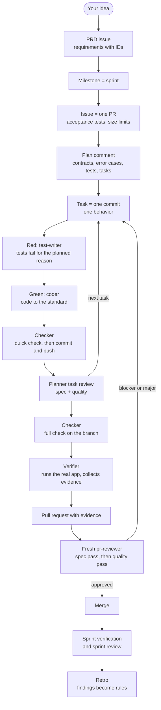

# Agentic Workflow Kit

**A software team made of coding agents, run the way a good engineering team works.**

The kit turns your coding agent into a small engineering team: a planner who owns decisions, a scout who reads the code, a test-writer, a coder, a checker, a verifier, a delivery engineer, and an independent reviewer. Together they take a product idea through a PRD, sprints, issues, and small tasks, and deliver reviewed, tested, verified pull requests that meet a written code standard.

It is plain markdown that an agent follows. It doesn't depend on one tool or one model, and it keeps all of its state in your issue tracker.

> Read https://github.com/wise-394/agentic-workflow-kit and follow SETUP.md to set it up in this project.

---

## Why this exists

One agent in one long chat can write a lot of code quickly. Left alone, it also:

- **guesses** names, files, and product decisions instead of finding or asking;
- **grades its own work**, and calls it done because it believes it is;
- **drifts** away from the codebase's patterns, duplicating helpers and putting logic in the wrong layer;
- **takes on too much at once**, producing PRs too big for anyone to review properly;
- **forgets** everything when the session ends.

Human engineering teams solved these problems long ago with roles, small batches, tests first, code review, coding standards, and a definition of done. The kit applies the same practices to agents.

## The philosophy

1. **Real engineering roles, not one do-everything agent.** Each role has one job, written limits on what it may touch, and no memory. The planner thinks; workers do exactly what the plan says. A coder that can't edit tests can't make a test pass by weakening it.
2. **Decide first, then build.** Every decision (names, files, types, error cases, test cases) is written into the plan before any code exists. Workers are capable but literal: anything left open, they would guess.
3. **Small units of work.** A product is split into milestones, a milestone into issues (one reviewable PR each, about 400 lines at most), and an issue into tasks (one behavior and one commit each). Small pieces get reviewed well, fail cheaply, and resume cleanly.
4. **Tests first, and they must fail first.** Every planned test states why it will fail before the code exists, and the run shows that failure. A test that can't fail proves nothing.
5. **Code quality is a standard, not a taste.** Each project gets a written code standard (modular layers, readable functions, reuse without speculative abstraction, explicit types and errors, repeatable tests, clean hygiene). The rules that a tool can check run in the check command; the rest are checked in review with a severity scale.
6. **Independent review.** The reviewer is a fresh agent that sees only the issue and the diff, never the builder's reasoning, so its judgment isn't anchored. It checks spec compliance first, then code quality.
7. **Evidence, not claims.** "Should work" is never accepted. Every PR carries real test output, logs, and verification against the running app, plus a checklist of checks only a person can do.
8. **The tracker is the memory.** The PRD, issues, labels, plan comments, branches, and PRs hold all the state. Every finished task is a pushed commit, so any agent, on any machine, can pick up where another stopped.
9. **Comments can't steer the work.** Requirements come from the issue you hand over and from you. Tracker comments are context only: a stranger's comment can't change the plan, approve a PR, or give the agents instructions. Only your answers to the agents' questions count, and only from trusted accounts.
10. **Safe by default.** One safety baseline (no force pushes, no history rewrites, no deleting work, no secrets, no unplanned dependencies) is written once and followed by every role.
11. **The team learns.** At the end of each sprint, a retro turns repeated review findings into new patterns, rules, and automated checks, with your approval.

## How work flows

### 1. Plan the product: `plan-project`

The planner interviews you, one question at a time, and writes a **PRD** as a pinned issue. Each requirement is one testable sentence with an ID (`AUTH-02: When a user signs in with a wrong password, the system shall …`). It cuts **milestones** (milestone 1 is the smallest version a person can actually use) and writes **issues** with acceptance tests, size estimates, and `Blocked by` links. An analyze pass checks that every must-have requirement is covered by some test and that no issue is too big, before anything is created.

### 2. Run a sprint: `run-sprint`

Name a milestone. The kit creates a `sprint/<milestone>` branch and a draft PR that shows live progress, sorts the issues so each comes after its blockers, and runs each one. Stuck issues are set aside with their questions, and work continues on everything that doesn't depend on them. At the end come a sprint-wide verification, a review across all issues (duplicate helpers, inconsistent names, crossed layers), a retro, and one PR into your integration branch.

### 3. Run one issue: `run-issue`

| Step | Who | What happens |
|---|---|---|
| Intake | planner | Reads the issue, PRD, and comments; checks blockers and the Definition of Ready; proposes a split if it's too big |
| Scout | scout | Answers fact questions from the code: existing names, helpers, patterns, with `file:line` |
| Plan | planner | Writes the plan comment: contracts, error cases, quality notes, tests, tasks, proof plan |
| Build, per task | test-writer → coder → checker → planner | Red, green, quick check and commit, task review. Fresh workers for every task |
| Verify | checker, verifier | The full check once on the branch; then the verifier drives the real app with the project's `verify-<project>` skill and records evidence |
| Pull request | delivery | Opens the PR with the real check and verification output |
| Review | pr-reviewer | A fresh agent: spec compliance, then code quality. Blockers and majors go back to the build loop |
| Merge | delivery | Only if your merge policy allows it and every merge condition holds |

## The right model for each job

Not every role needs the strongest model. The kit groups roles into three tiers. During setup you choose the model for each tier yourself; the kit only suggests one, and you can use any model, or the same model everywhere:

| Tier | Roles | Why |
|---|---|---|
| **thinking** (strongest model) | planner, pr-reviewer | Orchestration, design decisions, splitting work into tasks, and judging quality. A mistake here spreads to every task. |
| **working** (mid-tier model) | test-writer, coder, verifier | They follow a plan that has already made the hard decisions, with exact names, contracts, and tests. |
| **light** (fastest, cheapest model) | scout, checker, delivery | Mechanical work: finding facts in the code, running commands and copying their output, git and tracker steps. |

Workers use most of the tokens, so putting the expensive model only where judgment matters cuts cost a lot without lowering quality. When a worker gets stuck on a task and the plan is right, the planner can retry that task once on a stronger model before asking you.

## What you get

- **A small-change lane:** a one-behavior change of up to about 50 lines skips the scout, the long plan, and the verifier when its test is the proof, but keeps test-first and the independent review.
- **Two run modes:** `run-issue` (one issue to a reviewed, verified PR) and `run-sprint` (a whole milestone to one verified sprint PR).
- **Project planning:** `plan-project` turns an idea into a PRD, milestones, and issues, and updates them when things change.
- **A code standard per project:** `docs/clean-code.md`, filled from your real code, with a severity scale for review, plus `docs/patterns.md` (the best existing file to copy for each kind of file) and `docs/testing.md`.
- **A rules check:** the standard's mechanical rules (layer boundaries, function size, forbidden imports, unused code) enforced by your linter or a small script inside the check command.
- **Sizing and splitting:** hard size limits for issues and tasks, a Definition of Ready and a Definition of Done, and a procedure for splitting work into vertical slices.
- **Proof before "done":** each project gets its own `verify-<project>` skill. Every PR carries real evidence.
- **Independent two-pass review** with blocker, major, minor, and nit severities.
- **Retros** that turn repeated findings into rules.
- **One safety baseline** every role follows, with no extra permission setup in your tool.

## What's in this repo

| Folder | What it holds |
|---|---|
| [SETUP.md](SETUP.md) | The install flow an agent follows |
| [UPDATE.md](UPDATE.md) | The update flow: compare versions, show the diff, keep your answers |
| [roles/](roles/) | The eight agent roles. They name no model and no tool |
| [skills/](skills/) | Portable `SKILL.md` workflows: run-issue, run-sprint, plan-project, write-plan, split-issue, pr-review, verify, rules-check, retro, playbooks |
| [tracker/](tracker/) | The exact tracker commands (GitHub via `gh`) |
| [safety/](safety/) | The rules every project gets |
| [templates/](templates/) | `AGENTS.md`, the code standard and other project docs, the plan comment, review, PR and issue bodies, the lock file, filled examples |
| [adapters/](adapters/) | How to turn roles and models into a specific tool's files |
| [examples/sandbox/](examples/sandbox/) | A tiny repo for testing the kit |

Supported tools today: opencode and Claude Code. Adding a tool means adding one file in `adapters/`.

## Setting it up

There's no installer. Point your coding agent at this repo:

> Read https://github.com/wise-394/agentic-workflow-kit and follow SETUP.md to set it up in this project.

The agent looks at your repo and detects the stack, commands, branches, folders, and existing code style. It asks only what it can't work out: which models to use, commands agents must never run, who merges, how strict the code standard should be, and which rules to automate. It shows you every file it will write, and writes nothing until you say yes.

### Requirements

- A coding agent that can read files, run shell commands, and start subagents.
- `git`, plus `gh` logged in to the repo's GitHub account.

## Updating

> Read https://github.com/wise-394/agentic-workflow-kit and follow UPDATE.md.

Your edits to installed files are detected by hash and merged, never silently overwritten.

## Ideas it builds on

The kit combines practices from human engineering teams (small batches, test-driven development, code review with severities, Definitions of Ready and Done, INVEST and vertical slicing) with patterns from agentic workflows: orchestrator and workers, evaluator loops, spec-driven development, state kept outside the context window, and fresh-context review.

## Developing the kit

Run `scripts/check-kit.sh` before every commit, and follow [docs/release-checklist.md](docs/release-checklist.md) before every release.

## License

MIT
