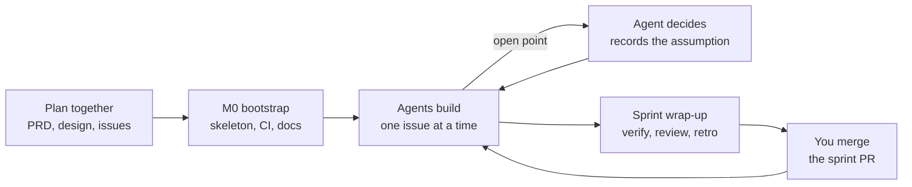

# agentkit

**Plan your product with your coding agent. Then a small team of agents builds it, issue by issue, with tests, reviews, and a merge you approve.**

agentkit is a plugin for coding agents such as Claude Code, opencode, and Codex. You install it once and drop it into any repository, even an empty one. It is plain markdown skills plus one bash script. It keeps no state of its own: the plan lives in your repo and the work lives in GitHub issues, so any session on any machine can pick up where the last one stopped.



## Quick start

**1. Install** in your coding tool.

| Tool | Install |
|---|---|
| Claude Code | `/plugin marketplace add wise-394/agentic-workflow-kit`<br/>`/plugin install agentkit@agentic-workflow-kit` |
| opencode | Clone and link the skills: [adapters/opencode.md](adapters/opencode.md) |
| Codex | Clone and link the skills: [adapters/codex.md](adapters/codex.md) |

**2. Set up** a project. Open your agent in the repository and say *"set up agentkit"*. It detects your repo, account, and commands, then asks about the rest: models, which of your installed skills to use, merge preference, and commands agents must never run. It shows every file before writing anything.

**3. Plan.** Say *"plan the project"*. The agent interviews you, pushes back on scope once, and writes `docs/prd.md`, `docs/design.md`, milestones, and issues with acceptance tests. Nothing is created until you approve it.

**4. Build.** Pick how much to hand over:

| You want | Say or run |
|---|---|
| Build one issue while you watch | `agentkit-run-issue #12` |
| See the plan before any code | `agentkit-run-issue #12 --plan-only` |
| Approve each task as it's built | `agentkit-run-issue #12 --step` |
| Build a whole milestone in one session | `agentkit-run-sprint M1` |
| Run unattended, around the clock | Point a runner at `agentkit-next` ([how](#running-unattended)) |

**Requirements:** `git`, the GitHub CLI `gh` logged in, a GitHub repository, and an agent that can run shell commands and start subagents or fresh sessions.

## How an issue gets built

Each issue is built by a team of roles. The thinking-heavy roles get your strongest model; the roles that follow a plan get a cheaper one.

| Step | Who | What happens |
|---|---|---|
| Intake | planner | Checks the issue is trusted, ready, and small enough. Splits it itself if it's too big |
| Scout | scout | Finds the existing names, helpers, and patterns, with `file:line` |
| Plan | planner | Writes contracts, error cases, tests, and tasks into one plan comment on the issue |
| Build | builder | One agent per issue builds every task: a failing test first, then the code, then a checked commit. Quick-lane issues are built by the planner itself |
| Check | `agentkit check-task` | The script runs format, tests, and checks, then commits |
| Verify | verifier | Proves the change in the running app, following `docs/verify.md` |
| Review | your review skill (optional), then pr-reviewer | Spec compliance, then code quality. Blockers come back as fix tasks |
| Merge | `agentkit merge` | Into the sprint branch, only with an approval on the exact head commit and passing checks |

When every issue in a milestone is merged, wrap-up runs a sprint-wide check, a cross-issue review, and a retro that proposes new rules. Then the sprint PR is marked ready with every assumption listed, and **you merge it**. Agents never merge a sprint into your main line.

**Model tiers.** *thinking* (planner, pr-reviewer) makes the decisions and judges quality. *working* (scout, builder, verifier) carries them out. A stuck task gets one retry on the thinking model before you're asked.

## Bring your own skills

agentkit orchestrates; it doesn't rebuild what good skills already do. During setup it lists the skills you have installed and suggests one for each slot. You can also keep the kit's own step.

| Slot | Good fillers | Without one |
|---|---|---|
| `review` | Your tool's code-review skill | The kit's pr-reviewer alone. It always runs and has the final say |
| `qa` | A browser-testing or QA skill | `docs/verify.md` |
| `securityReview` | A security-review skill | The security section of your code standard |

## Talking to the agents

- **No questions, no waiting.** The loop runs on its own. When an issue leaves something open, the agent finds it in the docs and code, or makes the smallest choice that's easy to undo and records it as an assumption. Every assumption is listed in the sprint PR, so you review them all when you merge.
- **Blocked issues.** Only an issue with no safe way on is blocked, for example one that needs a secret. Your runner gets the reason in the result line; the loop goes on with other work. Fix the cause, then run `agentkit unblock <N>`.
- **Pausing.** Label any open issue `agentkit:pause` (works from your phone) to stop unattended runs. Close that issue to resume.
- **Changing the plan.** Say *"update the plan"*. The agent revises the docs and issues through a PR you approve.

## Running unattended

agentkit does **one unit of work per session**, then stops and prints a result line:

```
AGENTKIT_RESULT {"outcome":"merged","issue":12,"note":"","at":"20261123T101500Z"}
```

Your runner (cron, CI, a shell loop, or another agent) starts a fresh session, reads the outcome, and decides whether to run again, wait, or notify you. The script checks every outcome against GitHub, so a session can't claim work it didn't do.

```bash
while true; do
  claude -p "/agentkit:agentkit-next"   # or the command from your adapter
  # read .agentkit/last-result.json: run again, wait, or notify
done
```

The full contract, with every outcome and what to do about it, is in [reference/orchestrator.md](reference/orchestrator.md).

## Safety

| Layer | What it covers |
|---|---|
| **The script** | Exact issue matching, labels, closing finished work so it's never redone, merge rules, a one-runner lock, rescuing a crashed session's work instead of discarding it, and a cap on sessions per issue |
| **Your tool's permissions** (opt-in in setup) | Refuses force pushes, history rewrites, deletes, direct merges, and reading secrets |
| **Written rules** | Role boundaries, your code standard, and [reference/safety.md](reference/safety.md). Review catches breaks |

For unattended runs, also use a container or VM, a token scoped to one repository, a separate bot account if you can, and branch protection on your integration and default branches.

## What ends up in your project

| File | What it is |
|---|---|
| `.agentkit/config` | Settings: tracker, branches, commands, models, slots, limits |
| `AGENTS.md` | Facts about your project for every agent session. No workflow instructions; those live in the skills |
| `docs/prd.md`, `docs/design.md`, `docs/decisions/` | The plan you wrote together |
| `docs/clean-code.md`, `patterns.md`, `testing.md`, `verify.md` | How code is written, copied, tested, and proven in this project |
| A few adapter files | Only what your tool needs, for example agent files that pin models |

**Updating:** update the plugin (or `git pull` your clone), then say *"set up agentkit"* again. It adds what's missing and never overwrites your docs.

## Repository layout

| Path | Contents |
|---|---|
| [skills/](skills/) | The five entry skills: `agentkit-setup`, `agentkit-plan`, `agentkit-run-issue`, `agentkit-run-sprint`, `agentkit-next` |
| [roles/](roles/) | Prompts for scout, builder, verifier, and pr-reviewer |
| [scripts/agentkit](scripts/agentkit) | Every tracker and git write, in bash with `git` and `gh` |
| [reference/](reference/) | Safety baseline, tracker rules, and the runner contract |
| [templates/](templates/) | Config, `AGENTS.md`, project docs, and issue, plan, PR, and review bodies |
| [adapters/](adapters/) | Install and settings for Claude Code, opencode, and Codex |
| [tests/](tests/) | The kit's own checks; never installed into projects |

## Contributing

Run both checks before every commit:

```bash
tests/check-kit.sh        # structure, links, tool-neutral wording
tests/agentkit.test.sh    # the script against a fake gh
```

[tests/acceptance.md](tests/acceptance.md) is the end-to-end run on a throwaway repository.

## License

See [LICENSE](LICENSE).
